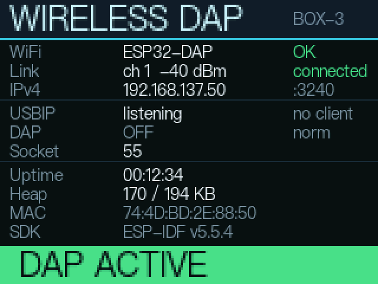

# 无线 CMSIS-DAP · ESP32-S3 移植版

## 分支说明

| 分支 | 对应硬件 | 说明 |
|---|---|---|
| `main` | —（共用基线） | 与硬件无关的改动（协议栈、工具脚本、文档）先落这里 |
| `S3Box` | Espressif **ESP32-S3-BOX-3 + Dock** | 已实测；额外带板载 2.4" LCD 状态屏 |
| **`DevKitC1`**（当前） | Espressif **ESP32-S3-DevKitC-1（N16R8）** | 从 `S3Box` 拉出以继承已调通的代码；关掉屏幕、console 改 UART0，SWD 引脚不变 |

> `DevKitC1` 从 `S3Box` 而不是 `main` 拉出，是为了直接继承 reset 修复、工具脚本等已在真机验证过的改动。
> 如果以后要把 `main` 作为纯净基线，可以把 `DevKitC1` 上的硬件无关提交挑回 `main`。

> 换板子要改哪些位置，见 [docs/移植说明.md](docs/移植说明.md) §3。

## 文档索引

| 文档 | 内容 |
|---|---|
| **[docs/手动操作手册.md](docs/手动操作手册.md)** | 日常操作：usbip 挂载 → 启动 OpenOCD → CubeIDE 连接 → 烧录（elf/hex/bin）→ 擦除/回读 → 排障 |
| **[docs/移植说明.md](docs/移植说明.md)** | 移植到 ESP32-S3 改了哪些东西 + **换 ESP32-S3-DevKitC-1 需要做什么** |
| **[docs/另一台电脑部署.md](docs/另一台电脑部署.md)** | **在新电脑上使用**：装 usbip、开热点、挂载、烧录、排查清单 |
| **[docs/状态灯说明.md](docs/状态灯说明.md)** | DevKitC-1 板载三色灯：颜色含义、状态机、改引脚、灯不亮怎么查 |
| 本 README | 项目背景、编译烧录、屏幕、性能与设计说明 |

## 板载状态屏（BOX-3）

盒子正面那块 2.4" 320x240 LCD 会实时显示运行状态，现场不看串口也能判断问题：



| 区域 | 内容 |
|---|---|
| 标题栏 | `WIRELESS DAP` + `BOX-3` |
| Wi-Fi | SSID / 信道 / 信号强度 / 连接状态 |
| 网络 | 本机 IPv4 与 USBIP 端口 |
| USBIP | 服务状态（listening / emulating …）与客户端连接情况 |
| DAP | 调试口类型（SWD / JTAG / OFF）与时钟模式 |
| 系统 | 运行时长 / 堆内存 / MAC / SDK 版本 |
| 底部状态条 | **青色 READY** / **绿色 DAP ACTIVE** / **红色 NO WIFI** |

设计要点（踩过的坑都写在 `main/display.c` 注释里）：

- 逐带绘制，不用整屏 framebuffer（省 150 KB 内存）
- 面板按 RGB565 **大端**接收，推屏前必须交换高低字节
- **必须等 DMA 传完再复用缓冲**（`on_color_trans_done` + 信号量），否则画面撕裂
- 字库是从 esp-box 的 LVGL 字体提取的 4bpp 点阵，**没有引入 LVGL**
- `USE_BOX3_DISPLAY` 可整体关闭（无屏板子如 DevKitC-1 置 0）

### 不用烧板子就能预览布局

`tools/render_preview.py` 在 PC 上用**同一套渲染算法**（解析同一份字体文件）出图：

```powershell
python .\tools\render_preview.py
# → docs/display_preview.png / docs/display_preview_2x.png
```

改完布局先看预览，确认没问题再烧录，能省掉大量来回。

---

把 [badboyhuan/wireless-esp32-dap](https://github.com/badboyhuan/wireless-esp32-dap)
（上游 windowsair/wireless-esp8266-dap）移植到 **ESP32-S3-BOX-3 + dock(PMOD2)**，
运行于 **ESP-IDF v5.5.4**。

原项目只支持 ESP8266 / ESP32 / ESP32C3 且基于 IDF 4.4；本仓库在保持协议栈不变的前提下
补齐了 ESP32-S3 硬件层、把 Wi-Fi/事件层迁移到 IDF 5.x，并改为 **SoftAP 模式**（无需路由器）。

---

## 1. 当前状态

| 项目 | 状态 |
|---|---|
| IDF 5.5.4 编译 | ✅ 通过（`wireless_esp_dap.bin` ≈ 742 KB，app 分区剩余 52%） |
| 烧录 COM3 | ✅ 通过 |
| 启动日志 | ✅ 正常，无 panic / 无重启 |
| SoftAP "DAP" | ✅ 已验证（旧的默认模式，现改为 STA） |
| **STA 连电脑热点 "ESP32-DAP"** | ✅ 已验证：1 秒内连接，静态 IP `192.168.137.50` |
| USBIP 服务 | ✅ TCP 3240 已监听，`usbip list/attach` 均正常 |
| Windows 驱动绑定 | ✅ WinUSB（WCID 自动绑定，`Wireless ESP CMSIS-DAP`） |
| **OpenOCD / CMSIS-DAP v2 全流程** | ✅ `Interface ready` |
| **SWD 烧录 / 校验 / 读内存 / halt** | ✅ 已验证（STM32F103xC，256 KB） |
| CubeIDE 交互式调试（断点/单步） | ⚠️ 不稳定，见下方说明 |
| 40 MHz SPI 加速 | ⛔ 未启用（见 §6） |

> **定位说明（2026-11）**：本项目的可靠用途是 **烧录固件 + 读写内存 + halt/resume**。
> 这三项在 OpenOCD 侧全部验证通过（写 3 KiB/s、校验 12 KiB/s、读 256 KB 无错误）。
> 但 **STM32CubeIDE 的交互式调试（F5 下载 + 断点 + 单步）仍不稳定**：
> CubeIDE 的 `load` 流程会走 OpenOCD 的 `reset init`，而 reset-init 在这条
> Wi-Fi + usbip + 位操作 SWD 的链路上会让 DP 失联（`Error connecting DP: cannot read IDR`）。
> 后续要修的话，方向是把 nRESET 接到 GPIO13 并启用 connect-under-reset，
> 或者让 DAP 在 reset 后自动重发 JTAG→SWD 切换序列。

实测通过的目标（OpenOCD 0.12 / STM32CubeIDE 1.19.0）：

```
Info : clock speed 300 kHz
Info : SWD DPIDR 0x1ba01477
Info : [stm32f1x.cpu] Cortex-M3 r1p1 processor detected
Info : [stm32f1x.cpu] target has 6 breakpoints, 4 watchpoints
Info : [stm32f1x.cpu] Examination succeed
0x08000000: 20000770 080001cd      ← 向量表：初始 SP + Reset_Handler
0x1ffff7e0: 0100                   ← Flash 容量 256 KB
pc (/32): 0x08001c2e
```

### ⚠️ SWD 速度：用 300 kHz，不要用 1 MHz

SWD 是 GPIO 位操作（S3 上 `USE_SPI_ACCEL == 0`），速度有硬上限：

| 请求速度 | 实测结果 |
|---|---|
| 200 / 300 kHz | ✅ 稳定（4/4 连续通过） |
| 500 kHz | ⚠️ 时好时坏 |
| 700 kHz | ✅ 能过，但没有余量 |
| 800 kHz+ | ❌ `cannot read IDR` |

CubeIDE 里把 **Debug → Adapter Speed 设为 300 kHz** 即可；脚本默认已改成 300。

### ⚠️ 两个必须知道的约束

1. **必须用 `--receive-mode low-latency` 挂载**

   ```
   usbip attach -r 192.168.137.50 -b 1-1 --receive-mode low-latency
   ```

   usbip-win2 默认的 `zero-copy` 模式会把 URB 串行化：一个 bulk-IN 读挂起时，
   bulk-OUT 写就发不出来，CMSIS-DAP 的「写命令 + 读应答」就会死锁，
   表现为 `busy command USB transfer` / `CMD_INFO failed`。
   `low-latency` 模式下读写可并行，实测一次通过。

2. **端点布局必须是「0x02 OUT 在前，0x81 IN 在后，0x83 IN 做 SWO」**

   OpenOCD 的 `cmsis_dap_usb_bulk.c` 硬性要求接口的 **endpoint[0] 是 bulk OUT**、
   **endpoint[1] 是 bulk IN**，否则直接 `skipping interface 0, endpoint[0] is not bulk out`。
   Keil 也不会硬编码端点号，所以这个布局两边都能用。

旧的 SoftAP 模式实测日志（节选，供对照）：

```
I (239) wifi: starting SoftAP ssid="DAP" password="12345678"
I (277) wifi:mode : softAP (74:4d:bd:2e:88:51)
I (281) wifi: SoftAP started
I (281) wifi: WIFI_AP_DEF ip: 192.168.4.1, gw: 192.168.4.1
Socket created / Socket binded / Socket listening
I (36665) wifi:station: bc:d2:2c:37:b7:1b join, AID=1
I (36980) esp_netif_lwip: DHCP server assigned IP to a client, IP is: 192.168.4.2
```

---

## 2. 硬件接线（DevKitC-1 排针）

本分支（`DevKitC1`）目标板是 **ESP32-S3-DevKitC-1（N16R8）**，SWD 引三根线到排针即可：

| 信号 | 板上的位置 | GPIO | 说明 |
|---|---|---|---|
| **SWDIO** | 排针 IO11 | **GPIO11** | S3 的 `FSPID` |
| **SWCLK** | 排针 IO12 | **GPIO12** | S3 的 `FSPICLK` |
| **nRESET**（可选） | 排针 IO13 | **GPIO13** | 开漏输出 + 内部上拉，接目标板 NRST |
| GND | 排针 GND | — | **必须与目标板共地** |

> **接电前务必确认 3V3 和 GND**。开发过程中曾因接反烧掉一块 F103。
> 稳妥做法是目标板自己 USB 供电，只连 SWDIO / SWCLK / GND（需要硬件复位时再接 nRESET）。

**DevKitC-1 比 BOX-3 省心的地方**：

- GPIO11/12/13 全在排针上，直接可接
- **GPIO13 不再和 SD 卡冲突**（BOX-3 上它是 SD_D1，插卡会干扰复位）
- 板子自带两个 USB 口，烧录用 UART 口（CH343，有自动复位），不用手动按 BOOT

**要注意的**：

- 本板没屏，`USE_BOX3_DISPLAY` 已置 0（`main/dap_configuration.h`）
- console 改到 **UART0（GPIO43/44）**，日志从烧录那个口直接看；别把 GPIO43/44 挪作他用
- PSRAM 保持关闭（和 BOX-3 一致），不影响功能

JTAG **没有**接线（TDI/TDO/nTRST 只是保持代码可编译），SWD 是默认调试口。

---

## 3. 编译与烧录

```powershell
# 已提供封装脚本（内部设置 IDF_PATH / IDF_TOOLS_PATH / IDF_PYTHON_ENV_PATH）
.\build.ps1 set-target esp32s3
.\build.ps1 build
.\build.ps1 -p COM13 flash
.\build.ps1 -p COM13 monitor
```

环境前提（本机已就绪）：

| 变量 | 值 |
|---|---|
| `IDF_PATH` | `D:\ESP32_SDK\esp32s3_v554\.espressif\v5.5.4\esp-idf` |
| `IDF_TOOLS_PATH` | `C:\Espressif` |
| `IDF_PYTHON_ENV_PATH` | `C:\Espressif\tools\python\v5.5.4\venv` |
| 工具链 | `xtensa-esp-elf esp-14.2.0_20260121` |

> 注：官方 `export.ps1` 在这台机器上会失败（它找 `C:\Espressif\python_env\idf5.5_py3.14_env`，
> 实际 venv 在 `tools\python\v5.5.4\venv`），并且缺 `C:\Espressif\espidf.constraints.v5.5.txt`。
> 这两点已修好/绕过，`build.ps1` 里全部显式指定。

---

## 4. 使用

**模式：ESP32-S3 作为 STA 连电脑热点**，电脑全程不需要断网。

1. 电脑打开"移动热点"，名称 **`ESP32-DAP`**，密码 **`12345678`**（**必须是 2.4 GHz 频段**）
2. 盒子地址固定为 **`192.168.137.50`**（Windows ICS 网段 `192.168.137.0/24`），USBIP 端口 **3240**
3. 电脑热点已开启时，`ping 192.168.137.50` 应能通

> 连接成功后串口会打印 `wireless DAP ready at 192.168.137.50:3240 (PC hotspot SSID "ESP32-DAP")`。
> 热点关掉后盒子会自动重连（每轮重试都会打印 disconnected reason），重新开热点即可恢复。

### 4.1 快速自检（不需要驱动）

```powershell
python tools\probe_usbip.py 192.168.137.50
# 期望: idVendor=0xc251 idProduct=0xf00a busid=1-1  + "USBIP handshake OK"
```

### 4.2 正式接入（usbip-win2）

**必须用 usbip-win2，不能用 cezanne 的 0.3.x**：0.3.x 的驱动是自签名测试驱动，
而本机 Secure Boot = 开启，Windows 会拒绝加载（现象：`vhci driver is not loaded`，
设备管理器里 `usbip-win VHCI(ude)` 停在 Error）。usbip-win2 的驱动带
Microsoft WHCP attestation 签名，Secure Boot 下可正常加载。

安装包：[USBip-0.9.8.1-x64.exe](https://github.com/vadimgrn/usbip-win2/releases/latest)
（本机已安装，CLI 在 `C:\Program Files\USBip\usbip.exe`）

```powershell
# 一键脚本：list + attach + 检查设备节点
powershell -ExecutionPolicy Bypass -File tools\attach-dap.ps1

# 等价的手工命令
& 'C:\Program Files\USBip\usbip.exe' list   -r 192.168.4.1
& 'C:\Program Files\USBip\usbip.exe' attach -r 192.168.4.1 -b 1-1
& 'C:\Program Files\USBip\usbip.exe' port
& 'C:\Program Files\USBip\usbip.exe' detach -p 0     # 卸载
```

成功后 Windows 会出现 **VID_0C251 / PID_F00A** 的设备（CMSIS-DAP v2，WinUSB）。
OpenOCD 示例：

```
adapter driver cmsis-dap
adapter speed 1000
transport select swd
```

> 由于驱动是 WinUSB(WCID)，OpenOCD 需要 libusb 后端；Keil 直接可用。

---

## 5. 相对上游的改动

### 5.1 构建系统（IDF 5.x）
- 根 `CMakeLists.txt`：`cmake_minimum_required 3.16`，保留项目根 include 路径（源码用 `main/...`、`components/...` 全路径引用）。
- 所有组件 `register_component()` → `idf_component_register()`。
- 移除 `ESP8266_RTOS_SDK` 子模块与 `components/corsacOTA`（`USE_OTA=0`）。
- 新增 `sdkconfig.defaults.esp32s3`（16 MB flash / QIO 80 MHz / 240 MHz / USB-Serial-JTAG 控制台 /
  1500 KB app 分区 / 关闭 WDT）。

### 5.2 IDF 4.4 → 5.5 API
| 文件 | 改动 |
|---|---|
| `main/wifi_handle.c` | **重写**：`esp_event_loop_init`+`system_event_t`+`tcpip_adapter_*` → `esp_netif` + `esp_event_handler_instance_register`；新增 SoftAP 模式 |
| `main/main.c` | `esp_event_loop.h`→`esp_event.h`；mDNS / corsacOTA 改为条件编译 |
| `main/timer.c` | ESP32/S3 用 `esp_timer_get_time()`（1 µs）作为时间戳源 |
| `main/tcp_server.c` 等 4 个文件 | 去掉 `esp_event_loop.h` |
| `main/wifi_configuration.h` | 新增 SoftAP 配置；`os_printf` 改为宏（避免 `__builtin_va_arg_pack` 兼容问题） |
| `components/DAP/include/swo.h` | 删除自造的 `EventGroupHandle_t`（与 IDF 5.x FreeRTOS 冲突） |

### 5.3 ESP32-S3 硬件层（新增）
| 文件 | 内容 |
|---|---|
| `components/DAP/include/gpio_common.h` | S3 分支：`soc/gpio_struct.h`、`soc/spi_struct.h`、`hal/gpio_ll.h` 等 IDF 5.x 扁平路径 |
| `components/DAP/include/gpio_op.h` | S3 分支：`out_w1ts/out_w1tc` 直接寄存器写 + `gpio_ll_*` |
| `components/DAP/config/DAP_config.h` | S3 引脚表（11/12/13）、`CPU_CLOCK 240 MHz`、`TIMESTAMP_CLOCK 1 MHz`、`PORT_JTAG_SETUP`/`PORT_OFF`/`PIN_nRESET_OUT` 等 S3 实现 |
| `components/DAP/include/DAP.h` | S3 的 `PIN_DELAY_SLOW` 汇编（用 `ADDI` 而非 `ADDI.N`，避免寄存器约束问题） |
| `components/DAP/source/DAP.c` | `BUS_CLOCK_FIXED 80 MHz`；SPI 加速用 `USE_SPI_ACCEL` 开关保护 |
| `components/DAP/source/SW_DP.c` | WAIT/FAULT 时钟周期走 S3 分支 |
| `components/DAP/source/spi_op.c` | S3 复用 C3 的 GPSPI2 寄存器序列 |
| `components/DAP/source/spi_switch.c` | S3 的 `DAP_SPI_Deinit()`（GPIO 恢复）；`DAP_SPI_Init()` 暂为空 |
| `main/dap_configuration.h` | 新增 `USE_SPI_ACCEL` 开关（S3 默认 0） |

---

## 6. 已知限制 / 后续

1. **40 MHz SPI 加速未启用**（`USE_SPI_ACCEL 0`）。当前 SWD 走 GPIO 位操作，2–5 MHz 量级，
   对 STM32 常规调试/烧写足够。S3 上要启用需要：GPSPI2 + IO_MUX `FUNC_GPIO11_FSPID` /
   `FUNC_GPIO12_FSPICLK`，并按 S3 的 `spi_dev_t` 字段（`ms_dlen`、`user2.usr_command_bitlen`、
   `user.sio`、`misc.cs0_dis`）重写 `DAP_SPI_Init()`。引脚已经为此准备好。
2. **mDNS 关闭**（`USE_MDNS 0`）：IDF 5.x 的 mDNS 是 managed component，需要联网拉包；
   暂时用固定 IP。启用可加 `main/idf_component.yml` 依赖 `espressif/mdns`。
3. **UART 桥 / OTA / KCP / elaphureLink** 沿用上游开关，默认关闭（elaphureLink 组件仍在编译）。
4. JTAG 未接线。

---

## 7. 故障排查

| 现象 | 处理 |
|---|---|
| 串口无输出 | 确认是 COM3（USB-Serial/JTAG 原生 USB），波特率随意；`idf.py -p COM3 monitor` |
| 搜不到 "DAP" 热点 | 确认固件已烧录（版本号/启动日志），确认 BOX-3 天线连接正常；先用 `netsh wlan show networks` 看一眼 |
| 连上热点但 ping 不通 | 网关应为 192.168.4.1；确认 PC 没有优先级更高的有线网络抢占默认路由 |
| `usbip attach` 失败 | 先跑 `python tools\probe_usbip.py` 确认 3240 端口与 USBIP 握手正常，再查驱动 |
| Keil 报 "RDDI-DAP ERROR" | 检查 SWDIO/SWCLK 是否接反、目标板是否共地、是否给了 3V3 |
